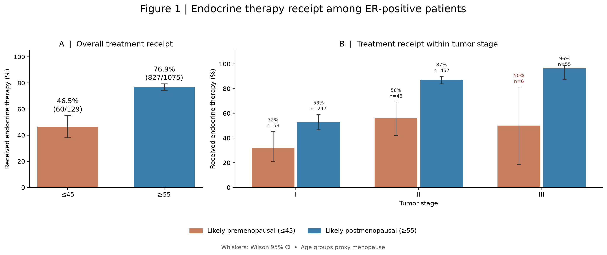
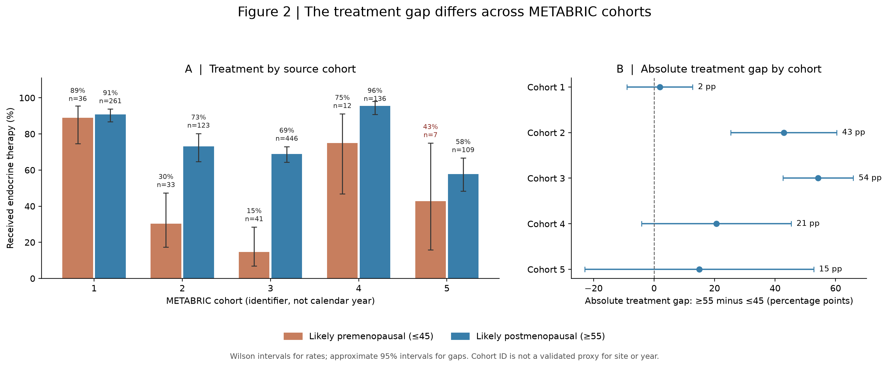
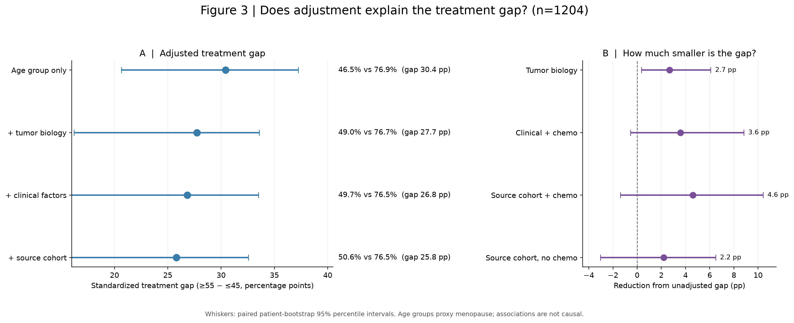

# Endocrine therapy patterns in ER-positive METABRIC breast cancer

**Software Engineering for Scientists — Assignment 7: Using Software Libraries**

## Hypothesis
Among patients with ER-positive breast cancer, endocrine therapy receipt differs between younger and older age groups used as proxies for menopausal status, and the association varies by source cohort and persists after accounting for recorded tumor characteristics.

This analysis is **exploratory**. The source-cohort question was formulated after examining the data.

## Introduction

Endocrine therapies inhibit estrogen-dependent tumor growth, whereas menopause changes circulating sex-hormone production. We asked whether patients *likely* to be premenopausal (age at diagnosis ≤45 years) and postmenopausal (≥55 years) differed in recorded endocrine therapy receipt, and whether recorded tumor characteristics and cohort account for the difference. We excluded ages 46–54 to avoid the menopausal transition. **These groups are age proxies, not verified menopausal states.** The METABRIC `hormone_therapy` column records cancer endocrine therapy, **not hormone replacement therapy**. Everyone analyzed had `er_status == "Positive"`.

Data: [METABRIC RNA / mutation / clinical CSV on Kaggle](https://www.kaggle.com/datasets/raghadalharbi/breast-cancer-gene-expression-profiles-metabric). Download `METABRIC_RNA_Mutation.csv` and place it in `data/`. The data CSV is intentionally excluded from Git tracking.

## Results

**Figure 1 — Overall difference and tumor stage.** Among 1,204 eligible ER-positive patients, endocrine therapy was recorded for **60/129 (46.5%)** patients aged ≤45 and **827/1,075 (76.9%)** patients aged ≥55: an absolute difference of **30.4 percentage points (pp)**. The older group had higher observed treatment rates within stages I, II and III; only **six** younger patients were classified as stage III, making that estimate imprecise.



**Figure 2 — Cohort heterogeneity.** The age-group treatment gap varied sharply across the five source cohorts, ranging from about **2 pp** (cohort 1) to **54 pp** (cohort 3). An exploratory logistic age-group × cohort interaction likelihood-ratio test gave **p = 0.00531**. Small younger-group counts in cohorts 4 and 5 limit precision; cohort identifiers do **not** directly encode calendar year, hospital, or prescribing practice.



**Figure 3 — Sequential adjustment and chemotherapy sensitivity.** We fitted logistic models to the **same 1,204 patients**, standardizing predictions to a common observed covariate distribution. The estimated age-group treatment gap was **30.4 pp** unadjusted, **27.7 pp** after adding PR status and PAM50 molecular subtype, **26.8 pp** after also adjusting for tumor stage, grade, HER2, and chemotherapy, and **25.8 pp** after further including cohort. Thus, the fully adjusted gap was only **4.6 pp smaller** than the unadjusted gap. Excluding chemotherapy from the final model gave a **28.2 pp** gap, a reduction of just **2.2 pp**. Panel B emphasizes these **small absolute reductions**, rather than visually exaggerating shifts in Panel A. The plotted bootstrap percentile confidence intervals are **preliminary**, based on only 40 resamples, and must not be used as strong evidence that any *reduction between models* differs from zero.



**Interpretation.** Recorded tumor features and cohort composition do **not eliminate** the treatment difference. However, a change in a standardized association after adjustment is **not** a causal decomposition of the disparity. In particular, chemotherapy is another treatment decision rather than a clean pretreatment confounder. Our results support an association with age-defined reproductive-life-stage proxies, **not an effect of menopause or estrogen concentrations**.

### What we would need to answer *why*

The data cannot determine whether the treatment gap is attributable to **actual menopause, sex-hormone physiology, or prescribing decisions**. To investigate those explanations, we would need **clinically assessed menopausal status** and **age/date at final menstrual period**, circulating **estradiol, FSH, and possibly progesterone** (ideally collected before treatment), and information on **ovarian suppression or oophorectomy**. We would also need **diagnosis/treatment calendar years**, **endocrine drug class and start date** (tamoxifen vs. aromatase inhibitor, duration, changes, adherence), contemporaneous treatment guidelines, and documentation of **contraindications, comorbidities, patient choice/refusal, access, and missing prescriptions**. Source-cohort labels and tumor expression profiles cannot replace these measurements. These unmeasured factors substantially limit mechanistic conclusions.

## Methods

1. Read the CSV with **pandas**; restrict to ER-positive tumors with valid binary `hormone_therapy` and ages ≤45 or ≥55, using `age_at_diagnosis` to define age groups. Do not use the dataset's age-derived `inferred_menopausal_state` as independently measured menopause.
2. Compute treatment counts and proportions by age group, tumor stage, and source cohort. Plot observed proportions with **Wilson 95% confidence intervals** using **matplotlib**, **NumPy**, and **SciPy**.
3. Compute cohort-specific absolute treatment-rate differences with approximate 95% normal intervals. Compare logistic regression models with and without an age-group × cohort interaction using a likelihood-ratio test (exploratory).
4. Fit nested binomial generalized linear models with a logit link (**statsmodels**): age group; then PR/PAM50; then stage/grade/HER2/chemotherapy; then cohort. Code missing categorical predictors as an explicit `Unknown` level, so all five cohorts remain represented; notably **all 148 eligible cohort 4 patients lack tumor stage**. This is a pragmatic missing-data strategy, **not imputation of true stage**.
5. For each model, predict endocrine treatment probability for every observed covariate record under each hypothetical age-group label; average predicted probabilities and subtract to obtain a standardized **association**, not a causal contrast. Repeat the final model **without chemotherapy** as a sensitivity analysis.
6. Use a seeded paired patient bootstrap to quantify variability in the standardized gaps and **their reductions relative to the unadjusted gap**. The bundled run uses **40 exploratory resamples** to keep the short assignment practical; use substantially more resamples for stable percentile intervals. Plot Figure 3 and export underlying CSV summaries.

### Reproduce the three figures

Prerequisites: Python 3.10+, downloaded METABRIC CSV (place at `data/METABRIC_RNA_Mutation.csv`) and a terminal in the repository root. On macOS/Linux:

```bash
python3 -m venv .venv
source .venv/bin/activate
python -m pip install -r requirements.txt
python src/analyze.py --input data/METABRIC_RNA_Mutation.csv --output results/figures --bootstrap 40 --seed 0
```

Or, on macOS, run `bash run_on_mac.sh`. For a more stable bootstrap interval on a sufficiently capable computer, replace `--bootstrap 40` with `--bootstrap 1000`. Results are saved to `results/figures/`, including the three PNGs, `cohort_absolute_gaps.csv`, `cohort_interaction_test.txt`, `sequential_model_results.csv`, and five model summaries. The same seed and library versions help reproduce results. Numerical tolerance and package versions may still affect estimates slightly.

### Software engineering and repository practices

The script uses a CLI (`argparse`), named functions, clear input/output arguments, no absolute user-specific paths, standard scientific Python libraries, checked required columns, seeded resampling, and separate figure and tabular outputs. Dependencies are declared in `requirements.txt`. The `.gitignore` excludes the original dataset, Python environments, caches, and operating-system files. **No unit or functional tests are included**, as the assignment expressly requests. The README includes a short introduction, results with plots, methods, and commands to reproduce the analysis.

### GitHub submission

After checking your files locally, create a new personal GitHub repository and run from this project folder:

```bash
git init
git branch -M main
git add README.md requirements.txt .gitignore run_on_mac.sh src data/README.md results/figures/*.png results/figures/*.csv results/figures/*.txt
git status
git commit -m "Add reproducible METABRIC endocrine therapy analysis"
git remote add origin https://github.com/YOUR_USERNAME/YOUR_NEW_REPOSITORY.git
git push -u origin main
```

Replace the example remote URL with your newly created repository URL. **Confirm that the raw `METABRIC_RNA_Mutation.csv` and `.venv/` are absent from `git status` before committing.** The repository creation and push must be carried out in your GitHub account; packaging a ZIP alone is not a Git commit.
